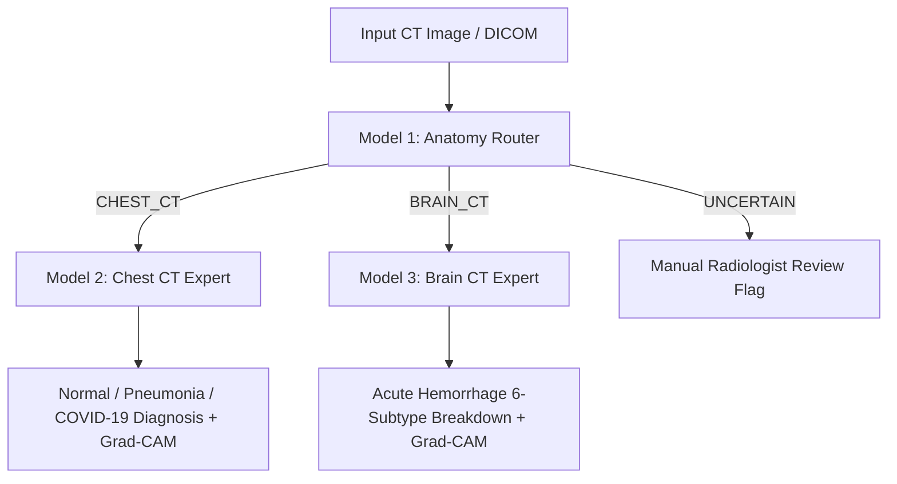

# Medical CT Multi-Model Unified Triage System

An end-to-end intelligent diagnostic pipeline and **interactive GUI decision support dashboard** integrating three medical deep learning models:



---

## Model Registry & Dedicated Documentation

| Model | Component Directory | Dedicated Guide | Architecture | Target Classes | Checkpoint File |
| :--- | :--- | :--- | :--- | :--- | :--- |
| **Model 1** | [`models/router/`](file:///c:/Users/adity/Downloads/ct_anatomy_router_output/models/router/) | [Router README](file:///c:/Users/adity/Downloads/ct_anatomy_router_output/models/router/README.md) | `EfficientNet-B0` | `CHEST_CT`, `BRAIN_CT` | [`best_router.pt`](file:///c:/Users/adity/Downloads/ct_anatomy_router_output/models/router/best_router.pt) (43.5 MB) |
| **Model 2** | [`models/chest/`](file:///c:/Users/adity/Downloads/ct_anatomy_router_output/models/chest/) | [Chest Expert README](file:///c:/Users/adity/Downloads/ct_anatomy_router_output/models/chest/README.md) | `EfficientNet-B0` | `Normal`, `Pneumonia`, `COVID-19` | [`best.pt`](file:///c:/Users/adity/Downloads/ct_anatomy_router_output/models/chest/best.pt) (54.7 MB) |
| **Model 3** | [`models/brain/`](file:///c:/Users/adity/Downloads/ct_anatomy_router_output/models/brain/) | [Brain Expert README](file:///c:/Users/adity/Downloads/ct_anatomy_router_output/models/brain/README.md) | `SE-ResNeXt-101` | `Any`, `Epidural`, `Intraparenchymal`, `Intraventricular`, `Subarachnoid`, `Subdural` | [`model_epoch_best_4.pth`](file:///c:/Users/adity/Downloads/ct_anatomy_router_output/models/brain/model_epoch_best_4.pth) (188.4 MB) |

---

## How to Run

### 1. Interactive GUI Dashboard (Default)

Running `pipeline_predict.py` without arguments launches the **Dark-Theme Diagnostic GUI Window**:
```bash
python pipeline_predict.py
```
Or launch with an image preloaded:
```bash
python pipeline_predict.py --image "samples/test_chest.png"
```

**GUI Features:**
- **Top Input Bar**: Address input field, `Browse Image...` button, and vibrant blue `Run Analysis` button.
- **Primary Results Card**: Anatomy routing, Disease diagnosis, Calibrated model confidence, and colored `NORMAL` / `ABNORMAL` badge.
- **Side-by-Side Canvas Previews**: Original input CT slice on the left, explainable **Grad-CAM attention heatmap** on the right.
- **Metrics Breakdown**: Real-time progress bars for each disease/subtype probability, router confidence, latency (ms), and architecture name.

---

### 2. Command-Line Interface (CLI Mode)

To run in the terminal:
```bash
# Multi-Layer Gradient Projection Grad-CAM (Default)
python pipeline_predict.py --cli --image "samples/test_chest.png"

# Standard Single-Layer Grad-CAM only
python pipeline_predict.py --cli --image "samples/test_chest.png" --single-layer

# Skip Grad-CAM for fastest console output
python pipeline_predict.py --cli --image "samples/test_brain.png" --no-gradcam
```

---

### 3. Multi-Layer Gradient Projection Engine

Unlike traditional Grad-CAM which hooks only the final convolutional layer (often resulting in coarse, low-resolution blobs), our **Multi-Layer Gradient Projection Engine**:
1. **Hierarchical Gradient Collection**: Registers simultaneous forward and backward hooks across multiple depth stages of the model (shallow, mid, deep, top).
2. **Point-wise Positive Gradient Projection (Layer-CAM)**: Projects spatial gradients $w_{k, i, j}^l = \text{ReLU}(g_{k, i, j}^l)$ directly onto activations $A_{k, i, j}^l$, preserving fine-grained micro-anatomical boundaries and lesion textures without spatial averaging loss.
3. **Gradient Energy Weighting**: Projects layer gradients to calculate layer contribution energy $\omega_l = \sqrt{\text{mean}(|g^l|) \cdot \text{mean}(|A^l|)}$, weighting earlier vs. deeper representations dynamically.
4. **Multi-Scale Fusion**: Bilinearly upsamples all layer projections to scan resolution $(H, W)$ and blends them into a sharp, clinically localized JET colormap overlay.

#### Hooked Model Stages:
- **Chest Expert (EfficientNet-B0)**:
  - `stage_2 (low)`: MBConv stage 2 (bronchovascular markings & fine edges)
  - `stage_4 (mid)`: MBConv stage 4 (regional lobar contours)
  - `stage_6 (deep)`: MBConv stage 6 (multifocal ground-glass opacities / consolidations)
  - `stage_8 (top)`: Conv2dNormActivation (global class-discriminative semantics)
- **Brain Expert (SE-ResNeXt-101)**:
  - `res_stage1 (low)`: Residual block 1 (calvarial bone & cranial boundary gradients)
  - `res_stage2 (mid)`: Residual block 2 (parenchymal & ventricular contours)
  - `res_stage3 (deep)`: Residual block 3 (acute blood hyperdensity localization)
  - `res_stage4 (top)`: Residual block 4 (global hemorrhage subtype classification)

---

### 4. Output Artifacts

Every prediction automatically creates a unique subdirectory under `predictions/<safe_name>/`:
- `prediction.json`: Full structured diagnosis, routing probabilities, and metrics.
- `*_gradcam_overlay.png`: High-contrast fused multi-layer gradient projection overlay.
- `*_gradcam_heatmap.png`: Raw multi-layer attention heatmap.
- `*_gradcam_multilayer_grid.png`: 6-panel progression grid comparing `Input CT` $\rightarrow$ `Layer 1` $\rightarrow$ `Layer 2` $\rightarrow$ `Layer 3` $\rightarrow$ `Layer 4` $\rightarrow$ `Fused CAM`.
- `*_layer_<name>.png`: Individual projected layer overlays.

